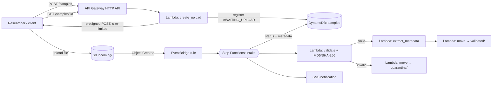
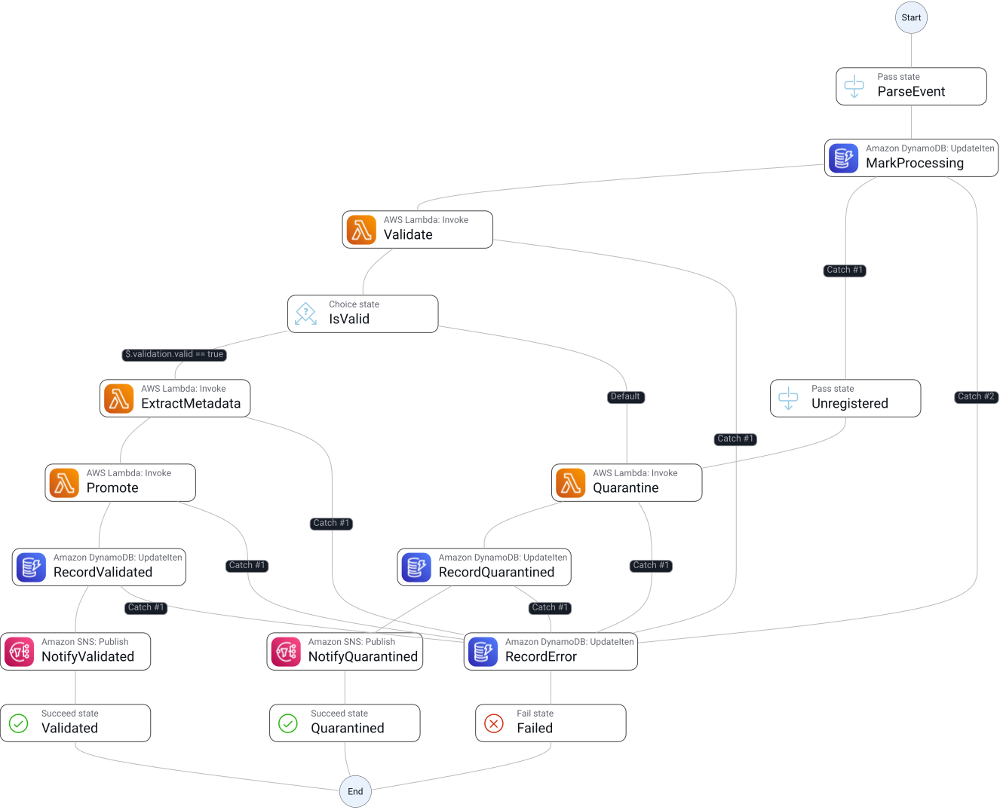

# SeqDrop: serverless intake for sequencing data

Researchers upload FASTQ or VCF files, and get back a **validated, checksummed and catalogued** dataset. Bad files get quarantined with a reason. There are no servers to patch and nothing runs while idle, so it costs nothing when nobody is uploading.

Built for the AWS Builder Center serverless weekend challenge with **API Gateway, Lambda, S3, Step Functions, DynamoDB, EventBridge and SNS**, all deployed with **Terraform**.

## Architecture



### Workflow states



Orange = Lambda; blue = DynamoDB and pink = SNS, both direct service integrations with no Lambda; every `Catch` edge leads to `RecordError`. Definition: [`infra/statemachine/intake.asl.json`](infra/statemachine/intake.asl.json).

`ParseEvent → MarkProcessing → Validate → IsValid?`
- **valid:** `ExtractMetadata → Promote → RecordValidated → NotifyValidated → ✅`
- **invalid:** `Quarantine → RecordQuarantined → NotifyQuarantined → ✅`
- **upload never registered via the API:** goes straight to quarantine
- **any unexpected error:** `RecordError → ❌` (and the sample record shows the error)

DynamoDB writes and SNS notifications are **direct Step Functions service integrations**, not Lambdas. Lambda only handles the work that needs code.

### What gets checked

| Format | Validation | Metadata extracted |
|---|---|---|
| FASTQ / FASTQ.gz | 4-line records, `@`/`+` lines, valid bases, sequence length = quality length, Phred+33 range, gzip integrity | reads, total bases, min/max/mean read length, GC%, first read ID |
| VCF / VCF.gz | `##fileformat=VCF`, 8 fixed `#CHROM` columns, consistent column count, integer POS, non-empty REF | variant count, VCF version, samples, chromosomes, SNV/indel/other counts |

Every file gets **MD5 and SHA-256** computed in the same streaming pass as validation, so memory use stays flat whatever the file size.

## Deploy

Prerequisites: Terraform ≥ 1.6 (or OpenTofu), the AWS CLI logged in to your account, plus `curl` and `jq`.

```bash
cd infra
cp terraform.tfvars.example terraform.tfvars   # set aws_profile + notification_email
terraform init
terraform apply
```

Confirm the SNS subscription email if you set one.

## Demo

```bash
src/scripts/demo.sh samples/good_R1.fastq.gz NA-demo-01       # → VALIDATED with metadata
src/scripts/demo.sh samples/good_tumour_normal.vcf TN-pair-01  # → VALIDATED, 2 samples, SNV/indel split
src/scripts/demo.sh samples/bad_length_mismatch.fastq          # → QUARANTINED: "Record 6: sequence length 75 != quality length 70"
src/scripts/demo.sh samples/bad_corrupt.vcf.gz                 # → QUARANTINED: corrupt gzip
```

API:

| Method | Path | Purpose |
|---|---|---|
| `POST` | `/samples` | `{"filename", "sample_name"}` → `sample_id` + presigned upload |
| `GET` | `/samples/{sample_id}` | Status, checksums, metadata, S3 location |
| `GET` | `/samples?status=VALIDATED` | List samples (uses the `by_status` index) |

## Tests

```bash
pip install pytest
python -m pytest -q tests/
```

These cover validation and metadata for every sample file locally, without needing AWS.

## Design decisions

- **Presigned POST rather than PUT**, so S3 rejects oversized uploads before they land (`content-length-range`).
- **Register before upload.** Only files with a sample record get processed. Anything else is quarantined, so the bucket can't be used as an anonymous drop box.
- **Sanitised object keys** (`incoming/<uuid>/<safe-filename>`), so the sample ID comes from the key with a Step Functions intrinsic and no Lambda.
- **Least privilege:** one IAM role per function, scoped to the prefixes and actions it actually uses.
- **Lifecycle rules** remove abandoned uploads after 7 days and quarantined files after 30.
- **Throttling** on the public API stage and **pay-per-request** DynamoDB, so a demo can't run up a bill.
- **arm64 Lambdas** for better price/performance.

## Limits and next steps

- **Large files.** Lambda's 15-minute limit makes it the wrong tool for multi-GB FASTQs. The next step is a size-based `Choice` that sends big files to an ECS Fargate or AWS Batch task, with the same contract, inside the same state machine.
- **Auth.** The demo API is open with throttling. For real use, add a Cognito JWT authoriser on the HTTP API and scope samples to projects.
- **Deeper QC.** Add a FastQC/`bcftools stats` container step and store the report next to the file.
- **Paired-end awareness.** Link R1/R2 under one sample and check that their read counts match.

## Tear down

```bash
cd infra && terraform destroy
```
