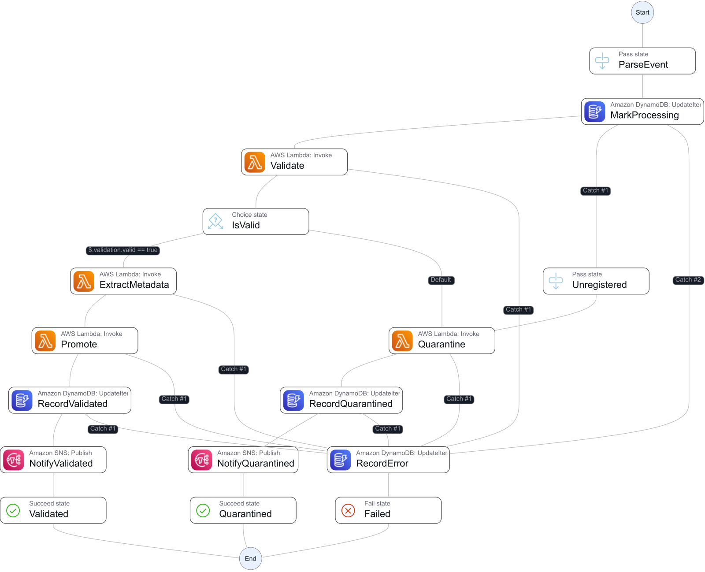

# SeqDrop: a serverless front door for sequencing data

*Weekend Challenge: No Pipeline, No Problem. I used seven serverless services (API Gateway, Lambda, S3, Step Functions, DynamoDB, EventBridge and SNS), deployed them with one `terraform apply`, and haven't had to touch a server since.*

## The problem

Sequencing files turn up in a research lab from all over the place. Some come from the core facility, some from collaborators, some from public archives, and some from whoever had them on a laptop. They're large, they're hard to replace, and more of them are quietly broken than you'd hope. If a FASTQ gets cut off halfway through a transfer, it still looks like a FASTQ. A VCF with a mangled header can sail through until it kills an analysis pipeline three hours in, and by then whoever uploaded it has gone home.

I wanted a single place to drop a FASTQ or VCF and get three answers straight away: is the file intact, what's in it, and where did it end up? If it's bad, it should be set aside with a reason someone can actually act on. If it's good, it should come back with checksums and a catalogue entry. Uploads come in bursts with long quiet gaps in between, so I didn't want to pay for anything during the gaps. That pretty much decided it: serverless.

## What it does

1. A researcher calls `POST /samples` with a filename and sample name. SeqDrop registers the sample in DynamoDB as `AWAITING_UPLOAD` and hands back a **presigned S3 POST** with a size limit baked in.
2. The file goes straight to S3. It never touches Lambda or API Gateway.
3. S3 emits an *Object Created* event, and an EventBridge rule kicks off a **Step Functions** workflow.
4. The workflow validates the file, computing MD5 and SHA-256 while it reads, and pulls out metadata. Then it moves the file to either `validated/` or `quarantine/`.
5. The sample record gets updated with its status, checksums, and either the metadata or the reason it was rejected. SNS sends a notification.
6. `GET /samples/{id}` shows the result. `GET /samples?status=QUARANTINED` lists everything that needs someone to look at it.

| Format           | Validation                                                                                                   | Metadata extracted                                                            |
| ---------------- | ------------------------------------------------------------------------------------------------------------ | ----------------------------------------------------------------------------- |
| FASTQ / FASTQ.gz | 4-line records, `@`/`+` lines, valid bases, sequence length = quality length, Phred+33 range, gzip integrity | reads, total bases, read length min/max/mean, GC%, first read ID              |
| VCF / VCF.gz     | `##fileformat=VCF`, 8 fixed `#CHROM` columns, consistent column count, integer POS, non-empty REF            | variant count, VCF version, sample names, chromosomes, SNV/indel/other counts |

## Architecture



There are three ways out of the workflow:

- **Valid file:** `Validate → ExtractMetadata → Promote → RecordValidated → NotifyValidated`
- **Invalid file:** `Validate → Quarantine → RecordQuarantined → NotifyQuarantined`
- **Something unexpected:** every task has a `Catch` that goes to `RecordError`. I didn't want samples stuck in `PROCESSING` forever with no explanation, so the record always says what went wrong.

## No pipeline, no problem

I don't have anything to run, patch or keep an eye on. All 60 resources go up with a single `terraform apply` from my laptop. There's no CI/CD pipeline, no containers and no instances. After it's deployed:

- **It costs next to nothing when idle.** Lambda, Step Functions, API Gateway and pay-per-request DynamoDB only bill when a file arrives. Between uploads I'm just paying for storage.
- **I don't have to think about scale.** Each upload gets its own workflow execution, whether there are ten of them or ten thousand.
- **I can trace any file.** Every sample record links to its Step Functions execution, so I can see which state a file got through and where it failed.

I picked Terraform over SAM or CDK because the rest of my infrastructure is already in it. The state machine is plain Amazon States Language in `infra/statemachine/intake.asl.json`, which means you can open it straight in Workflow Studio.

## Design decisions I'd defend

**Only use Lambda where I actually need code.** Three Lambdas do the real work: validating, extracting metadata and moving the object. Every DynamoDB write and SNS publish is a **direct Step Functions service integration** instead. I even pull the sample ID out of the S3 key with intrinsic functions (`States.ArrayGetItem(States.StringSplit(...))`) so I don't need a Lambda for it. Less code means fewer cold starts and fewer IAM roles I can get wrong.

**Files have to be registered before they're uploaded.** `MarkProcessing` is a conditional DynamoDB update, and it only succeeds if the sample came in through the API. If someone drops a file into the bucket any other way, the condition fails, and the workflow catches the `ConditionalCheckFailedException` and sends the file to quarantine. So nobody can use the bucket as an anonymous drop box.

**Presigned POST rather than PUT.** A POST policy can include a `content-length-range` condition, which means S3 turns away oversized uploads before it stores anything.

**Validation streams the file.** It reads the file as a stream and works out the checksums on the same pass, so memory use stays flat however big the file is.

**One role per function, with as little access as possible.** Each Lambda can only touch the S3 prefixes and actions it uses. The workflow role can invoke exactly three functions, update one table and publish to one topic.

**It's cheap to leave running.** DynamoDB is pay-per-request, the Lambdas run on arm64, the public API stage is throttled (10 requests/s, burst 20), and S3 lifecycle rules clean up abandoned uploads after 7 days and quarantined files after 30.

## Does it work?

The repo has some good sample files, some I broke on purpose, and a demo script that does the full round trip. Here's what I got against the live stack:

| File                        | Result                                                                      |
| --------------------------- | --------------------------------------------------------------------------- |
| `good_R1.fastq.gz`          | ✅ **VALIDATED**: 200 reads, 75 bp, GC 49.75%, MD5 and SHA-256 recorded      |
| `good_tumour_normal.vcf`    | ✅ **VALIDATED**: 4 variants, samples TUMOUR and NORMAL, 2 SNVs and 2 indels |
| `bad_length_mismatch.fastq` | 🚫 **QUARANTINED**: "Record 6: sequence length 75 != quality length 70"     |
| `bad_corrupt.vcf.gz`        | 🚫 **QUARANTINED**: "File is not valid gzip (corrupt or truncated)"         |

The rejection messages are what I care about most here. "Record 6: sequence length 75 != quality length 70" tells a researcher exactly what to fix. "Pipeline failed" tells them nothing.

## What bit me

**A 307 I couldn't find in any tutorial.** My first real uploads failed with HTTP 307. It turned out boto3 had signed the presigned POST against the global `s3.amazonaws.com` endpoint. If your bucket is outside us-east-1, and especially if it's brand new, S3 responds to that host with a temporary redirect, and clients won't re-send a multipart form across a redirect. Fixing it took one client setting: sign against the regional endpoint `s3.<region>.amazonaws.com` and use virtual-hosted addressing. Worth remembering if you're doing presigned uploads anywhere other than us-east-1.

**Provider deprecations.** AWS provider v6 deprecates `hash_key` and `range_key` on DynamoDB global secondary indexes and wants `key_schema` blocks instead. Not a big change, but I'd rather clear the warning now than wait for it to turn into an error.

**Noisy plans from `for_each`.** I built the workflow's IAM policy from `aws_lambda_function.fn[...].arn`. The catch is that changing the code of *any* Lambda in that `for_each` makes Terraform mark the policy as "known after apply". The policy doesn't really change, but it looks worrying in a plan. Building the ARNs from known names would get rid of that.

## What's next

- **Large files.** Lambda's 15-minute limit rules it out for multi-gigabyte FASTQs. I plan to add a `Choice` state that checks the file size and sends big files to an ECS Fargate or AWS Batch task with the same inputs and outputs, all inside the same state machine.
- **Auth.** A Cognito JWT authoriser on the HTTP API, with samples scoped to projects.
- **Deeper QC.** A FastQC or `bcftools stats` container step, with the report stored alongside the file.
- **Paired-end support.** Link R1 and R2 under one sample and check their read counts match.
- **Data protection.** DynamoDB deletion protection, Terraform `prevent_destroy`, and S3 versioning for anything holding real data.

## Try it

```bash
cd infra
cp terraform.tfvars.example terraform.tfvars   # set aws_profile (+ optional notification_email)
terraform init && terraform apply
cd ..
src/scripts/demo.sh samples/good_R1.fastq.gz NA-demo-01
src/scripts/demo.sh samples/bad_length_mismatch.fastq
```

Code: [**github.com/pharmlovex/seqdrop**](https://github.com/pharmlovex/seqdrop)

*#serverless #stepfunctions #lambda #terraform #bioinformatics*
